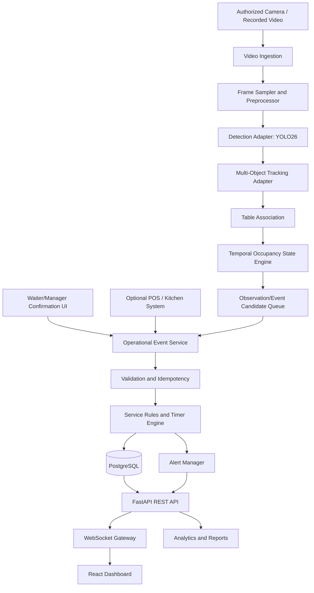

# 🏗️ SmartServe AI — System Architecture

**Document:** Architecture and Technical Design  
**Version:** 1.0  
**Status:** Proposed  
**Related document:** `PRD.md`

## 1. Purpose

This document describes the components, boundaries, data flow, deployment options, and technical decisions for SmartServe AI, a restaurant table occupancy and service-timing platform powered by computer vision.

The central architectural principle is to separate **visual observations**, **business events**, and **confirmed operational facts**. A person detected near a table is an observation; it is not automatically proof of waiter attendance. A tray-like object appearing near a table is not automatically proof that food was delivered. The system must preserve event source, confidence, and verification status.

## 2. Architecture Goals

- Monitor table occupancy from authorized camera feeds.
- Estimate customer counts and maintain stable table sessions.
- Calculate service intervals from timestamped events.
- Support manual confirmation and optional POS/kitchen integrations.
- Deliver dashboard updates and threshold-based alerts.
- Make components testable and replaceable.
- Minimize raw-video retention and personal data collection.
- Support a single-camera MVP and a path to multiple cameras.

## 3. Recommended Technology Decisions

| Area | Decision | Rationale |
|---|---|---|
| Language | Python 3.11+ (verify library compatibility) | Broad computer-vision ecosystem |
| Detection | Compatible YOLO26 implementation | Person/object detection; verify package and weights before pinning |
| Video I/O | OpenCV | Camera and frame processing |
| Tracking | ByteTrack or BoT-SORT adapter | Temporary identities across frames; benchmark both if needed |
| API | FastAPI | Typed request validation and OpenAPI support |
| Database | PostgreSQL | Reliable event and session persistence |
| Local prototype | SQLite may be used temporarily | Simple setup for early experiments |
| ORM/migrations | SQLAlchemy + Alembic | Schema management and migration history |
| Dashboard | React + TypeScript | Component-based live interface |
| Real-time updates | WebSocket, with REST fallback | Push table/alert changes to dashboard |
| Testing | pytest; frontend test tooling selected during setup | Unit and integration testing |
| Packaging | Docker Compose for local services | Repeatable developer environment |

**Model compatibility gate:** Confirm the chosen YOLO26 package, weights, inference API, license, and hardware support before implementation. Keep detector integration behind an interface so the model package can be replaced without rewriting business logic.

## 4. High-Level System Diagram



## 5. Component Responsibilities

### 5.1 Video Ingestion

**Responsibilities**
- Open webcam, authorized IP-camera stream, or test video.
- Reconnect with bounded exponential backoff after failures.
- Attach camera ID and capture timestamp to frames.
- Track last successful frame and stream health.
- Avoid logging credentials or full connection URLs.

**Inputs:** camera configuration.  
**Outputs:** timestamped frames and camera-health events.  
**Failure behavior:** mark camera as degraded/disconnected, emit a health event, and avoid treating missing frames as proof that a table is vacant.

### 5.2 Frame Sampler and Preprocessor

- Enforce configurable frame sampling and input dimensions.
- Preserve the original capture timestamp even if processing is delayed.
- Keep inference work bounded; use a queue with a documented drop policy for stale frames.
- Do not persist frames by default.

### 5.3 Detection Adapter

Define a provider-neutral interface such as `detect(frame) -> list[Detection]`. A detection contains `class_name`, `confidence`, and normalized or pixel-coordinate bounding box. The initial implementation focuses on people; other classes should be enabled only when the selected model supports them and the use case is validated.

- Filter invalid boxes and low-confidence predictions.
- Record model name/version and inference latency.
- Keep rendering/debug overlays separate from business logic.

### 5.4 Tracking Adapter

- Accept detections and frame timestamps.
- Return temporary track IDs and associated boxes.
- Handle short missed detections and ID switches as expected limitations.
- Never treat a track ID as a permanent customer or employee identity.
- Expose tracker configuration and version in diagnostics.

### 5.5 Table Configuration and Association

Each table has a stable table ID and one or more configured regions linked to a camera. Region coordinates should be stored in a normalized coordinate system so resizing the stream does not invalidate the floor plan.

Association strategy for the MVP:
1. Map each person's lower-center point or configured anchor point into the camera's coordinate plane.
2. Test whether the anchor falls inside a table polygon, optionally combined with overlap and persistence checks.
3. Score competing table associations when polygons overlap.
4. Return `associated`, `ambiguous`, or `unassigned` rather than forcing a guess.

Table regions require an administrator calibration workflow and validation preview.

### 5.6 Temporal Occupancy State Engine

- Convert noisy frame observations into stable candidate transitions.
- Apply configurable persistence and vacancy grace periods.
- Open a table session only after occupancy is confirmed.
- Keep a session active during brief occlusion or short detection loss.
- Mark ambiguous conditions for review.
- Emit state-transition events; do not directly send dashboard messages from the vision loop.

The engine must be deterministic for a given sequence of timestamped observations and configuration so it can be unit-tested using recorded scenarios.

### 5.7 Operational Event Service

Accepts event candidates from computer vision, waiter confirmation UI, manager corrections, and optional POS/KDS integration.

Each event records:
- event ID and event type;
- table and session references;
- event occurrence timestamp and server-recorded timestamp;
- source (`vision`, `waiter_ui`, `manager_ui`, `pos`, `kds`);
- verification status (`candidate`, `confirmed`, `corrected`, `rejected`);
- optional confidence and evidence metadata;
- actor ID when a person confirms or edits it;
- idempotency key where a source may retry delivery.

### 5.8 Validation and Idempotency

- Validate event types and required fields.
- Reject impossible timestamp ordering or flag it for review.
- Prevent duplicate processing when the same external event is retried.
- Use database transactions for event creation and related session updates.
- Preserve the original event when a correction is made; add a correction/audit record rather than silently rewriting history.

### 5.9 Service Rules and Timer Engine

- Calculate intervals from event timestamps, not frame counts.
- Derive metrics only when required source events exist and are eligible.
- Support per-restaurant or per-service-type thresholds.
- Re-evaluate unresolved alerts when a qualifying event arrives.
- Make rule evaluation idempotent and testable.

### 5.10 Alert Manager

- Evaluate configurable alert rules.
- Deduplicate repeated alerts for the same unresolved condition.
- Track `active`, `acknowledged`, and `resolved` lifecycle states.
- Publish updates through the API/WebSocket layer.
- Never equate an alert with proof of employee fault.

### 5.11 API and Real-Time Gateway

REST handles configuration, queries, confirmations, corrections, exports, and historical analytics. WebSocket messages carry small update notifications such as table-state changes, new alerts, and camera-health changes. Clients should be able to recover by re-fetching authoritative state from REST after reconnecting.

### 5.12 Analytics and Reporting

- Query confirmed/eligible events and completed sessions.
- Apply documented definitions for mean, median, delay rate, utilization, and turnover.
- Show sample sizes and completeness rates.
- Filter by authorized restaurant, shift, section, table, and date range.
- Use background jobs for expensive exports if volume grows.

## 6. Data Flow

### 6.1 Live Occupancy Flow
1. Camera produces a frame with capture timestamp.
2. Ingestion assigns camera ID and health metadata.
3. Frame sampler submits a current frame to the detector.
4. Detector returns person boxes and confidence scores.
5. Tracker associates boxes with temporary track IDs.
6. Table association maps tracks to configured regions.
7. Temporal state engine accumulates evidence over time.
8. Confirmed transition creates an occupancy event and opens/closes a session.
9. Database transaction persists event and state.
10. API/WebSocket updates the dashboard.

### 6.2 Attendance Flow
1. Waiter or authorized manager selects a table/session and confirms attendance; alternatively, a validated candidate may be shown for confirmation.
2. Backend verifies permission, active session, timestamp, and idempotency key.
3. Event is persisted with source and verification status.
4. If it is the first eligible attendance event, the service timer is finalized.
5. Alert rules are recalculated and dashboard state is published.

### 6.3 Food Delivery Flow
1. Waiter confirms delivery, or an integrated POS/KDS sends an event.
2. Backend maps the event to a table/session and validates the source.
3. Event is persisted as confirmed or candidate, depending on source and configured policy.
4. First-delivery and subsequent-delivery metrics are updated.
5. Related alerts are resolved or recalculated.

### 6.4 Camera Failure Flow
1. Ingestion misses frames beyond a configured timeout.
2. Camera status changes to degraded/disconnected.
3. System health alert is created.
4. Occupancy state is marked stale/uncertain; it is not automatically set to vacant.
5. On recovery, processing resumes and the dashboard receives a health update.

## 7. Domain Model and Relationships

- `Restaurant` has many `Table`, `Camera`, `User`, and `ServiceEvent` records.
- `Camera` has one or more configured table regions.
- `Table` has many `TableSession` records over time.
- `TableSession` has many `ServiceEvent` and `Alert` records.
- `User` can have role assignments and time-bounded waiter assignments.
- `Alert` may reference a table, session, camera, or system event.
- `AuditLog` records administrative changes and event corrections.

Use UUIDs for internal identifiers and human-readable codes such as `T05` for display.

## 8. Suggested Backend Package Structure

```text
src/smartserve/
├── main.py
├── config.py
├── api/
│   ├── dependencies.py
│   ├── routes/
│   └── websocket.py
├── vision/
│   ├── interfaces.py
│   ├── video_ingestion.py
│   ├── detector.py
│   ├── tracker.py
│   └── table_association.py
├── occupancy/
│   ├── state_machine.py
│   └── sessions.py
├── events/
│   ├── schemas.py
│   ├── service.py
│   └── validation.py
├── rules/
│   ├── timers.py
│   └── alerts.py
├── analytics/
│   ├── metrics.py
│   └── reports.py
├── database/
│   ├── models.py
│   ├── repositories.py
│   └── session.py
├── security/
│   ├── auth.py
│   └── permissions.py
└── integrations/
    ├── pos.py
    └── kds.py
```

## 9. Deployment Topology

### MVP
- One Python application process for video processing and API, separated into modules.
- PostgreSQL service, or SQLite for a disposable local prototype.
- React development server.
- One authorized camera or a recorded sample video.

### Pilot / Growth
- Separate vision worker from API process so inference load does not block HTTP requests.
- Use a bounded queue between vision and event processing.
- PostgreSQL with migrations and backups.
- Reverse proxy with HTTPS for remote access.
- Optional message broker only when measured throughput or multi-worker requirements justify it.

Do not introduce Kafka, Kubernetes, or multiple microservices into the MVP without a measured requirement.

## 10. Configuration

Use environment variables for secrets and deployment-specific values. Keep non-secret examples in `config/*.example.yaml`.

Configuration categories:
- camera source and reconnect policy;
- model path/provider and inference thresholds;
- frame sampling and processing resolution;
- table polygons and association parameters;
- occupancy persistence and vacancy grace period;
- service delay thresholds;
- event retention and optional video retention;
- database URL and API settings.

Commit `.env.example`, never real credentials, private stream URLs, or production tokens.

## 11. Reliability and Observability

Track at minimum:
- camera last-frame time and connection state;
- processing FPS and dropped-frame count;
- detection and tracking latency;
- event-processing failures;
- database health and transaction errors;
- WebSocket connection count and reconnects;
- active alerts and oldest unresolved alert;
- event correction rate and uncertain-event rate.

Use structured logs with correlation IDs. Do not log raw video, credentials, or unnecessary personal information.

## 12. Security and Privacy

- Enforce authentication and role-based authorization in backend routes.
- Restrict camera-feed and export access.
- Protect secrets using environment configuration or a secret manager.
- Use HTTPS for remote deployment and secure database credentials.
- Prefer local video processing and avoid storing continuous video by default.
- Document signage/notice, lawful basis, retention, access, and deletion procedures with qualified review.
- Keep employee performance analytics contextual, auditable, and unsuitable for automatic disciplinary decisions.

## 13. Testing Strategy

- Unit tests for state transitions, metrics, threshold rules, idempotency, and permission checks.
- Replay tests using deterministic timestamped observation sequences.
- Integration tests for database transactions and API flows.
- Contract tests for POS/KDS adapters.
- Vision evaluation on labeled representative footage.
- Load tests with the target number of cameras and resolution.
- Recovery tests for camera, database, and WebSocket interruptions.

## 14. Key Technical Decisions to Revisit

1. Exact YOLO26 package, model weights, license, and runtime compatibility.
2. ByteTrack versus BoT-SORT performance on the target footage.
3. Required hardware and target processing FPS.
4. Whether camera regions overlap and whether a table can be seen by multiple cameras.
5. Attendance and food-delivery event source of truth.
6. Data retention duration and local-versus-cloud deployment.
7. Whether POS/KDS integration is in the MVP or a later phase.

## 15. Definition of Architecture Complete

- Component boundaries and interfaces are documented.
- Event schema records source and verification status.
- Occupancy state transitions are deterministic and testable.
- Database entities and API boundaries are agreed.
- Failure behavior for camera loss and uncertain events is specified.
- Privacy, security, and retention assumptions are documented.
- Model and tracker dependencies are verified before implementation is pinned.

---

## 16. Surveillance & Vision Architecture (Refactor)

### 16.1 View Segregation & Zero-Inference Policy
The Surveillance & Vision subsystem exposes two dedicated, primary views:
1. **Standard CCTV (`StandardCctvView`):** Multi-camera, view-only facility security. Streams raw CCTV video without triggering computer vision models, tracker states, occupancy machines, or analytics events.
2. **Tracking View (`TrackingView`):** Operational computer vision monitoring. Feeds are registered incrementally across restaurant floors and automatically linked to the fine-tuned YOLO26 model (`models/yolo26_restaurant_cctv.pt`) and ByteTrack.

### 16.2 Fine-Tuned YOLO26 Model & Inference Pipeline
- Model checkpoint: `models/yolo26_restaurant_cctv.pt` (fine-tuned on dining CCTV dataset; mAP50 = 0.7416).
- Inference worker manager (`TrackingWorkerManager`): Idempotent worker lifecycle with state persistence in `tracking_jobs` and `cameras`.
- Automatic resource cleanup: Camera deletion halts active tracking workers, terminates OpenCV handles, and preserves historical analytics data.

### 16.3 Dynamic Floor and Central Analytics Aggregation
- **Floor-Level KPIs:** Calculated per restaurant floor (monitored tables, occupancy rate, seated patrons, service timers, alerts) dynamically created upon adding a floor's camera.
- **Central Restaurant KPIs:** Aggregated strictly from raw numerators and denominators across active floors (never direct sums of averages or percentages).
- **Deduplication:** Canonical table mappings prevent double counting across overlapping camera angles.
- **Scope Segregation:** Explicitly distinguishes `LIVE_ACTIVE_SOURCES`, `HISTORICAL_SHIFT`, and `COMBINED`.

