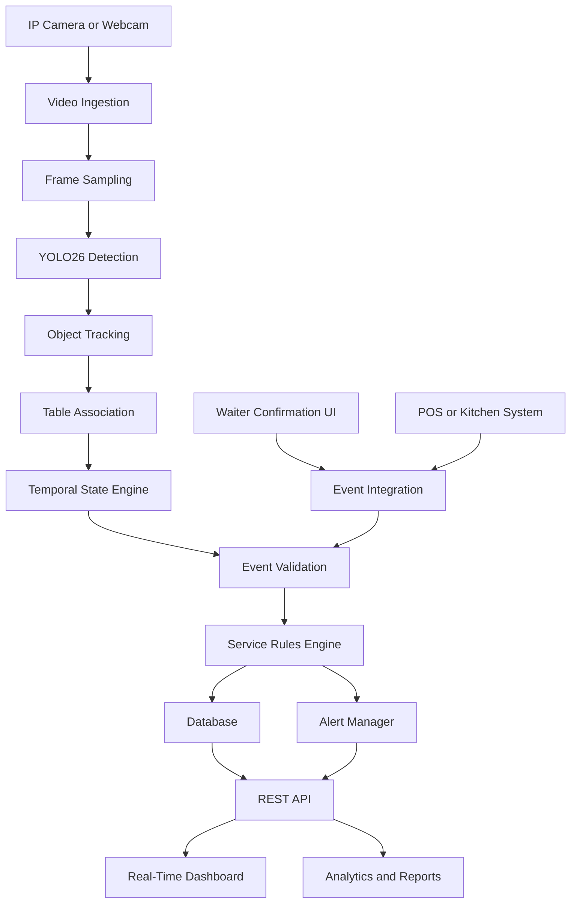
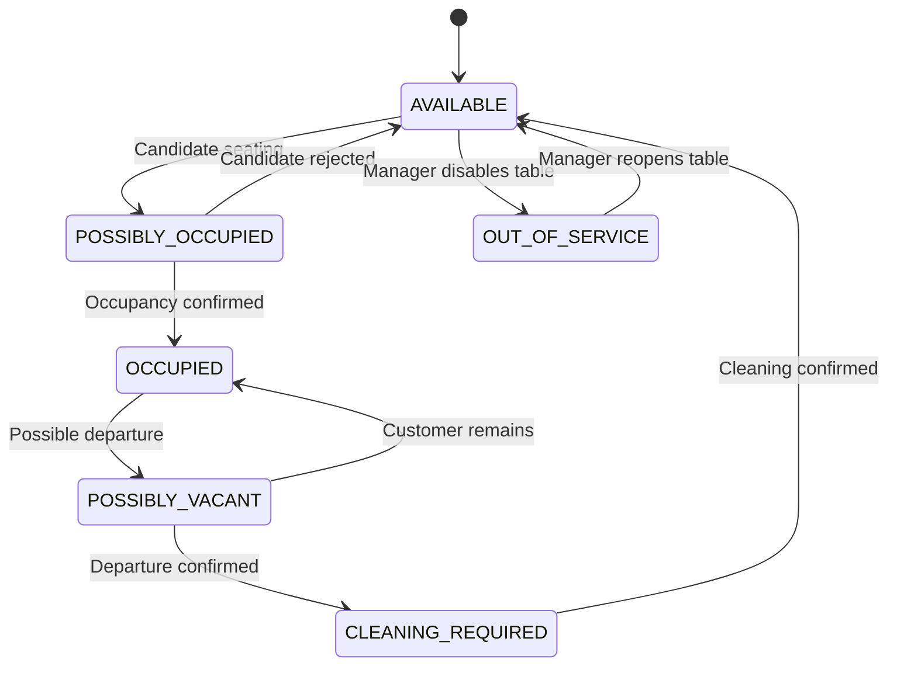
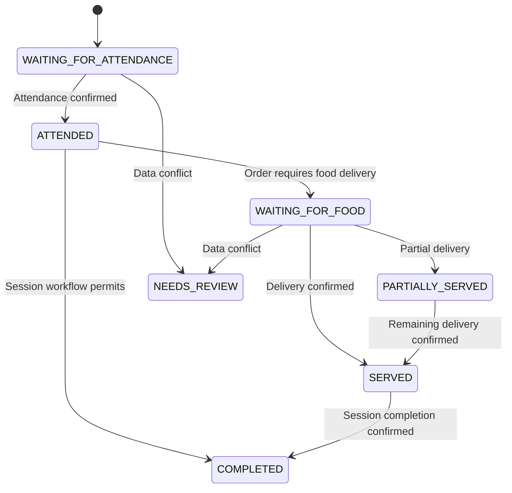

# 🍽️ YOLO26 Restaurant Table Occupancy & Service Timer
## Product Requirements Document (PRD)

**Project Name:** SmartServe AI  
**Document Type:** Product Requirements Document  
**Version:** 1.0  
**Status:** Proposed  
**Primary Technology:** YOLO26, Python, OpenCV  
**Backend:** FastAPI or Flask  
**Dashboard:** React or HTML/CSS/JavaScript  
**Database:** PostgreSQL or SQLite for the MVP  
**Target Users:** Restaurant owners, managers, waiters, and operations teams

---

# 1. 📌 Project Overview

## 1.1 Introduction

SmartServe AI is an AI-powered restaurant monitoring and service analytics platform designed to improve restaurant operations through computer vision, object tracking, event detection, and real-time data visualization.

The system uses camera feeds to monitor restaurant tables, detect customers, estimate table occupancy, track waiter activity, and calculate important service timings.

By combining visual observations with staff inputs and optional Point of Sale (POS) integration, the system provides actionable insights into customer waiting times, food delivery delays, table utilization, and service performance.

## 1.2 Problem Statement

Restaurants frequently face operational challenges such as:

- Customers waiting too long before a waiter attends their table.
- Difficulty identifying occupied and vacant tables in real time.
- Lack of accurate data about service response and food delivery times.
- Manual tracking of table turnover and customer occupancy.
- Difficulty identifying service bottlenecks during peak hours.
- Inconsistent methods of evaluating waiter performance.
- Missed opportunities to improve seating efficiency and customer satisfaction.

Traditional manual monitoring depends heavily on staff observations and handwritten records. These methods may be inconsistent and do not provide continuous, measurable operational insights.

SmartServe AI aims to automate observable restaurant workflows and consolidate them into a single monitoring and analytics platform.

## 1.3 Proposed Solution

The platform will:

1. Detect people and other relevant objects in camera footage using YOLO26.
2. Associate detected people with predefined table regions.
3. Maintain table occupancy states and occupancy timers.
4. Track staff movement and table visits where camera visibility permits.
5. Record first-attendance and food-delivery events.
6. Calculate service timing metrics.
7. Generate configurable alerts for delayed service.
8. Provide real-time dashboards and historical reports.
9. Integrate staff confirmation and POS events where visual evidence is insufficient.
10. Help restaurant managers identify operational bottlenecks.

## 1.4 Product Vision

To build a reliable, privacy-conscious AI assistant that helps restaurants deliver faster service, improve table utilization, and make evidence-based operational decisions.

---

# 2. 🎯 Product Objectives

## 2.1 Primary Objectives

- Automate table occupancy monitoring.
- Estimate the number of customers seated at each table.
- Measure the time between seating, first attendance, and food delivery.
- Track waiter-table interactions.
- Identify delayed or unattended tables.
- Calculate table turnover and occupancy statistics.
- Provide live operational visibility to restaurant managers.
- Generate reports that support service improvement.

## 2.2 Success Criteria

The following targets are initial engineering goals, not guaranteed model performance. They should be validated using representative footage from the target restaurant.

| Metric | Initial Target |
|---|---:|
| Person detection precision | ≥ 90% |
| Table occupancy classification accuracy | ≥ 90% |
| Customer counting accuracy | ≥ 90% |
| Table-to-person association accuracy | ≥ 90% |
| Dashboard event update latency | ≤ 3 seconds |
| Event timestamp recording error | ≤ 2 seconds |
| Service alert delivery after threshold | ≤ 5 seconds |
| Camera stream processing availability | ≥ 95% during pilot operation |

**Measurement note:** Each metric must have a documented evaluation method. For example, occupancy accuracy should be evaluated over labeled time intervals, while counting accuracy should compare predicted and manually verified customer counts.

## 2.3 Out of Scope for the Initial MVP

- Facial recognition to identify individual employees or customers.
- Emotion recognition or subjective customer satisfaction scoring.
- Automatic payroll calculation.
- Automatic disciplinary decisions based on AI predictions.
- Autonomous food preparation or delivery.
- Guaranteed detection of food being served from ordinary camera footage.
- Guaranteed identification of individual waiters when uniforms and visual evidence are insufficient.
- Automated restaurant-wide optimization without manager approval.

---

# 3. 👥 Target Users and Stakeholders

| User Role | Responsibilities | Main Needs |
|---|---|---|
| Restaurant Owner | Oversees restaurant operations | Business analytics, turnover, service efficiency |
| Restaurant Manager | Manages daily service | Live table status, alerts, reports |
| Waiter | Serves assigned tables | Clear task visibility and service reminders |
| System Administrator | Configures the platform | Users, cameras, tables, thresholds |
| Analyst | Reviews operational performance | Historical data, comparisons, trends |
| Customer | Receives restaurant service | Shorter waits and more consistent service |

## 3.1 User Permissions

- **Administrator:** Manage users, camera configurations, table layouts, system settings, and access policies.
- **Manager:** View live monitoring, acknowledge alerts, review reports, and correct service events.
- **Waiter:** View permitted assignments and confirm attendance or delivery events.
- **Analyst:** Access authorized reports and aggregated performance metrics.

Permissions must be enforced by the backend, not just by hiding dashboard controls.

---

# 4. 🔄 Core User Journey

1. An administrator configures the restaurant, tables, cameras, and service thresholds.
2. The system connects to an authorized camera feed.
3. YOLO26 detects people in incoming frames.
4. A tracking algorithm assigns persistent track IDs to detected people.
5. The system associates people with configured table regions.
6. Occupancy logic identifies a likely seating event.
7. A table session begins and its occupancy timer starts.
8. A waiter interaction is detected or manually confirmed.
9. The system records the first-attendance timestamp.
10. Food delivery is confirmed through a supported visual event, staff input, or POS integration.
11. The system calculates service intervals and updates the dashboard.
12. Configured thresholds trigger alerts when service is delayed.
13. After the table becomes vacant, the session is closed following a configurable confirmation period.
14. Historical metrics are stored and included in reports.

**Important:** The system should distinguish an observed event from a confirmed event. For example, a person approaching a table is not necessarily a waiter attending to it, and an object placed on a table is not necessarily food delivery.

---

# 5. 🧩 Functional Requirements

## FR-01: Restaurant and Table Configuration

**Description:** Allow administrators to configure the restaurant floor plan and define individual tables.

### Requirements

- Create, edit, activate, and deactivate tables.
- Assign a unique table ID, such as `T01`, `T02`, or `T05`.
- Define table shape and region using polygon or rectangle coordinates.
- Associate table regions with a camera.
- Support multiple tables within a single camera view.
- Support multiple camera feeds where hardware permits.
- Configure table-specific settings when required.
- Display camera connectivity and configuration status.
- Store floor-plan configuration persistently.

### Acceptance Criteria

- Each active table has a unique identifier.
- Table regions can be saved and loaded after application restart.
- Invalid or overlapping configurations are flagged for administrator review.
- Each table is linked to the appropriate camera or cameras.

## FR-02: Person Detection

**Description:** Detect people in camera frames using YOLO26.

### Requirements

- Load the selected YOLO26-compatible model and its weights.
- Process video frames at a configurable resolution and frame rate.
- Detect people and return bounding boxes, confidence scores, and class labels.
- Allow confidence and inference settings to be configured.
- Draw optional bounding boxes on a monitoring preview.
- Handle missed detections and temporary occlusion.
- Record model version and inference configuration.
- Allow the detection component to be replaced without redesigning the dashboard.

### Acceptance Criteria

- Person detections are returned in a documented format.
- Low-confidence detections can be filtered.
- Camera failures and model loading errors are reported clearly.
- The system can process the configured pilot camera under the target hardware constraints.

## FR-03: Person Tracking

**Description:** Maintain temporary identities for detected people across video frames.

### Requirements

- Integrate a compatible multi-object tracker, such as ByteTrack or BoT-SORT, subject to compatibility testing.
- Assign a temporary tracking ID to each tracked person.
- Preserve IDs across short periods of missed detection where possible.
- Handle entry, exit, occlusion, and re-entry scenarios.
- Associate tracking observations with timestamps.
- Avoid treating tracking IDs as permanent employee or customer identities.

### Acceptance Criteria

- A person moving through adjacent frames is tracked consistently where feasible.
- Temporary occlusion does not automatically generate a new seating session.
- Track loss is handled through configurable timeout logic.

## FR-04: Table Occupancy Detection

**Description:** Determine whether a table is occupied using person locations and configured table regions.

### Requirements

- Associate person detections with table regions using a defined spatial rule.
- Support centroid-in-polygon or bounding-box overlap approaches.
- Estimate the number of customers associated with each table.
- Maintain table occupancy states:
  - `AVAILABLE`
  - `POSSIBLY_OCCUPIED`
  - `OCCUPIED`
  - `POSSIBLY_VACANT`
  - `CLEANING_REQUIRED`
  - `OUT_OF_SERVICE`
- Require temporal confirmation before changing critical states.
- Allow manager corrections.
- Track confidence and the evidence supporting a state transition.

### Acceptance Criteria

- A transient person passing beside a table does not automatically mark it occupied.
- Occupancy changes require configurable persistence or confirmation rules.
- Managers can correct incorrect table states.
- State changes are recorded in an audit history.

## FR-05: Customer Counting

**Description:** Estimate how many customers are seated at each table.

### Requirements

- Count tracked people associated with a table region.
- Avoid counting the same tracked person multiple times in the same time window.
- Apply temporal smoothing to reduce rapid count fluctuations.
- Display current estimated customer count.
- Support manual count correction.
- Store count snapshots at configurable intervals.
- Mark counts as uncertain when people are heavily occluded or outside the camera view.

### Acceptance Criteria

- The dashboard shows a current customer-count estimate for every monitored table.
- Count fluctuations caused by missed detections are reduced through temporal logic.
- Manual corrections are logged with the user and timestamp.

## FR-06: Occupancy Session Management

**Description:** Create and manage a session for each table's period of customer occupancy.

### Requirements

When a table becomes occupied:

- Create a unique session ID.
- Record the seating or occupancy-start timestamp.
- Record the estimated number of customers.
- Set the initial service status.
- Start the occupancy timer.

During the session:

- Update occupancy duration.
- Record customer-count changes.
- Record attendance and food-delivery events.
- Maintain a history of relevant state changes.

When the table becomes vacant:

- Start a vacancy-confirmation timer.
- Confirm departure only after the configured conditions are satisfied.
- Record the session end timestamp.
- Calculate total occupancy duration.
- Mark the table available or cleaning-required according to configured workflow rules.

### Acceptance Criteria

- Each confirmed occupancy period has one unique session ID.
- Temporary occlusion does not unnecessarily split the session.
- Session start and end timestamps are retained for reporting.
- Incomplete sessions are recoverable after an application restart where supported.

## FR-07: Waiter Activity Tracking

**Description:** Record staff interactions with tables and associate confirmed interactions with staff members when possible.

### Requirements

- Detect person movement near table regions.
- Support optional staff registration and permitted identity-association methods.
- Support assignment of waiters to sections or tables.
- Provide manual waiter selection when identity is uncertain.
- Record first-attendance events.
- Record subsequent service interactions when required.
- Display the latest observed or confirmed interaction.
- Maintain a confidence or verification status for each event.

### Identity Association Options

1. **Manual confirmation:** A waiter selects their identity when confirming a table visit.
2. **Operational assignment:** A table is associated with an assigned waiter or section.
3. **Visual classification:** A model distinguishes staff from customers using suitable training data and visual cues.
4. **Optional authorized identity technology:** Only after a separate privacy, legal, security, and accuracy review.

### Acceptance Criteria

- The system does not automatically assign a staff identity when evidence is insufficient.
- Each attendance event records its source and verification status.
- Managers can correct incorrect waiter associations.
- Uncertain events are excluded from definitive staff performance comparisons or clearly reported separately.

## FR-08: First Attendance Detection

**Description:** Calculate the time between seating and the first confirmed waiter attendance.

### Requirements

- Record the session start timestamp.
- Record the first confirmed attendance timestamp.
- Calculate first-response time.
- Prevent duplicate first-attendance events for the same session.
- Allow an authorized user to correct the event.
- Display the result in the dashboard.

### Formula

$$
T_{\text{response}} = T_{\text{first attendance}} - T_{\text{seating}}
$$

### Acceptance Criteria

- The timer starts at the configured seating event.
- The first confirmed attendance event stops the response timer.
- If attendance is not confirmed, the metric remains pending and alerts may be triggered.
- Corrected events retain their audit history.

## FR-09: Food Delivery Tracking

**Description:** Record the time food is delivered to a table.

### Supported Event Sources

- Waiter-confirmed food delivery.
- POS or kitchen-display-system integration.
- An explicitly trained visual event detector, when suitable labeled data is available.
- A hybrid workflow combining visual evidence and staff confirmation.

### Requirements

- Record the food-delivery timestamp.
- Associate delivery events with the correct table session.
- Support multiple deliveries per session.
- Distinguish first delivery from subsequent deliveries.
- Allow authorized correction of mistaken events.
- Store event source, confidence, and confirmation status.
- Handle cases where food is delivered in multiple batches.

### Acceptance Criteria

- A food-delivery timestamp is not inferred solely from a waiter approaching a table.
- The first-delivery metric is calculated only when an eligible delivery event exists.
- Unconfirmed visual detections are clearly labeled as estimates.
- POS or manual events can be reconciled with the camera timeline.

## FR-10: Service Time Calculations

**Description:** Calculate service metrics for each table session.

### Required Metrics

| Metric | Definition |
|---|---|
| First Response Time | First confirmed attendance minus seating time |
| Time to First Food Delivery | First confirmed food delivery minus seating time |
| Attendance-to-Delivery Time | First food delivery minus first attendance |
| Total Occupancy Duration | Confirmed session end minus seating time |
| Time Since Last Interaction | Current time minus last recorded interaction |
| Service Completion Time | Configured completion event minus seating time |
| Table Turnover | Number of completed sessions per table over a selected period |

### Formulas

$$
T_{\text{first food}} = T_{\text{first delivery}} - T_{\text{seating}}
$$

$$
T_{\text{attendance to food}} =
T_{\text{first delivery}} - T_{\text{first attendance}}
$$

$$
T_{\text{occupancy}} = T_{\text{session end}} - T_{\text{seating}}
$$

$$
\text{Table Turnover Rate} =
\frac{\text{Completed Sessions}}{\text{Number of Tables}}
$$

The turnover formula above represents sessions per table over the selected reporting period. A time-normalized turnover rate can additionally be reported as completed sessions per table-hour.

### Acceptance Criteria

- Durations are calculated using timestamps rather than accumulated frame counts.
- Missing events produce an `N/A` or pending value rather than a fabricated duration.
- Negative or inconsistent event intervals are flagged for correction.
- Reports state which events are confirmed versus estimated.

## FR-11: Service Delay Alerts

**Description:** Notify authorized staff when service events exceed configured thresholds.

### Alert Types

- Table occupied but not attended.
- First response time exceeds the allowed limit.
- Food delivery exceeds the configured limit.
- Table has had no recorded interaction for an unusual duration.
- Camera feed has disconnected.
- Table occupancy state is uncertain for an extended period.
- Event timestamps or session data are inconsistent.

### Example Rules

| Rule | Example Threshold | Action |
|---|---:|---|
| First attendance overdue | 3 minutes | Warning |
| First attendance critically overdue | 5 minutes | High-priority alert |
| First food delivery overdue | 15 minutes | Warning |
| No interaction for an extended period | 10 minutes | Review alert |
| Camera disconnected | 30 seconds | System alert |

These are sample values for configuration, not universal restaurant service standards.

### Requirements

- Allow administrators to configure thresholds.
- Support warning and critical severity levels.
- Avoid repeated notifications for the same unresolved condition.
- Provide alert acknowledgment and resolution actions.
- Record alert creation, acknowledgment, and resolution timestamps.
- Support dashboard notifications and optional email or messaging integrations.

### Acceptance Criteria

- Alerts are generated only when their configured conditions are satisfied.
- Acknowledged alerts are not repeatedly emitted at every processing frame.
- Alert history is available to authorized managers.
- Threshold changes are audited.

## FR-12: Unusual Activity Detection

**Description:** Flag potentially unusual operational events for review.

### Supported Events

- A table appears vacant while objects remain on it.
- A table remains occupied for an unusually long period.
- A customer appears to leave before a service milestone.
- A table appears to be awaiting cleaning.
- Staff interaction is not recorded within the expected interval.
- A table's detected occupancy conflicts with a manual or POS state.

### Requirements

- Define configurable rules for unusual activity.
- Record event time, table ID, associated session, and supporting evidence.
- Display alerts for manager review.
- Permit false-positive dismissal and correction.
- Avoid automatically asserting intent, misconduct, theft, or employee negligence.

**Limitation:** Ordinary camera footage may not reliably determine whether objects are personal belongings, unfinished food, or abandoned items. Such events must be treated as review flags rather than definitive conclusions.

## FR-13: Real-Time Dashboard

**Description:** Provide a live operational overview of the restaurant.

### Dashboard Components

1. Total configured tables.
2. Occupied tables.
3. Available tables.
4. Tables requiring cleaning.
5. Active customer sessions.
6. Total estimated customers.
7. Average first-response time.
8. Average time to first food delivery.
9. Active service alerts.
10. Camera connection status.

### Table Monitoring View

Each table card should display:

- Table ID.
- Occupancy state.
- Estimated customer count.
- Occupancy timer.
- First-attendance status.
- Food-delivery status.
- Assigned or confirmed waiter, when available.
- Service status.
- Active alerts.
- Last event timestamp.

### Service Status Values

- `WAITING_FOR_ATTENDANCE`
- `ATTENDED`
- `WAITING_FOR_FOOD`
- `PARTIALLY_SERVED`
- `SERVED`
- `COMPLETED`
- `NEEDS_REVIEW`

Status transitions must be configurable to support different restaurant workflows.

### Acceptance Criteria

- Table status updates without requiring a manual page refresh.
- Dashboard metrics correspond to the underlying stored events.
- Filters can be applied by table, status, waiter, and time period.
- Uncertain events are visually distinguished from confirmed events.

## FR-14: Waiter Performance Analytics

**Description:** Provide operational summaries of service activity for authorized managers.

### Metrics

- Number of tables handled.
- Number of confirmed attendance events.
- Average first-response time.
- Median first-response time.
- Average attendance-to-delivery time, where data is available.
- Percentage of attended tables within the configured service threshold.
- Number of overdue tables.
- Number of completed table sessions associated with the waiter.

### Calculation Example

$$
\text{Average Response Time} =
\frac{\sum_{i=1}^{n} T_{\text{response},i}}{n}
$$

$$
\text{On-Time Response Rate} =
\frac{\text{Eligible Sessions Within Threshold}}
{\text{Eligible Sessions}} \times 100
$$

### Requirements

- Filter reports by date, shift, and restaurant section.
- Exclude missing or unverified event intervals from confirmed averages.
- Show sample size and data completeness alongside metrics.
- Allow managers to inspect the events behind an aggregate.
- Provide a fair comparison that accounts for shift and section differences where data permits.

**Important:** Analytics should be used for operational improvement, not as the sole basis for employee discipline. Camera coverage, task complexity, staffing levels, and event-confirmation quality can all affect results.

## FR-15: Historical Reports and Export

**Description:** Generate historical service and occupancy reports.

### Report Types

- Daily restaurant performance.
- Weekly and monthly service trends.
- Table utilization and turnover.
- Customer waiting-time distribution.
- Service delay frequency.
- Waiter activity summaries.
- Peak-hour occupancy.
- Camera and system reliability.
- Event correction and data-quality reports.

### Requirements

- Filter by date range, table, section, and permitted staff identifiers.
- Export authorized data to CSV.
- Provide downloadable summaries where supported.
- Include report-generation time and selected filters.
- Apply access controls to employee-level reports.
- Ensure exported metrics match the selected reporting criteria.

## FR-16: User Authentication and Authorization

### Requirements

- Provide secure login and logout.
- Support role-based access control.
- Protect administrative routes and API endpoints.
- Store passwords using an appropriate password-hashing algorithm if local authentication is implemented.
- Use secure session or token management.
- Enforce authorization for sensitive exports and settings.
- Log important administrative actions.

## FR-17: Configuration and Audit History

### Requirements

- Store table layouts, camera configuration, alert thresholds, and application settings.
- Support controlled configuration changes.
- Record who changed important settings and when.
- Record manual event corrections and their reasons.
- Support backup and restoration of essential operational data.
- Validate settings before applying them.

---

# 6. 🤖 AI and Computer Vision Requirements

## 6.1 AI Pipeline

The system should separate visual detection from business rules and event recording.

**Processing pipeline:**

Camera Feed → Frame Sampling → YOLO26 Detection → Multi-Object Tracking → Table Association → Temporal State Estimation → Event Generation → Database → Dashboard and Alerts

## 6.2 Detection Layer

Responsibilities:

- Read frames from a camera.
- Resize or preprocess frames as required.
- Run inference with the selected YOLO26 model.
- Filter detections by class and confidence.
- Return bounding boxes, class labels, confidence values, and timestamps.

## 6.3 Tracking Layer

Responsibilities:

- Associate detections across frames.
- Maintain temporary track identities.
- Estimate trajectories and motion.
- Handle temporary disappearance.
- Provide track observations to the table-association module.

## 6.4 Table Association Layer

Responsibilities:

- Load configured table regions.
- Determine whether a tracked person is seated near a table.
- Estimate per-table occupancy.
- Maintain temporal evidence.
- Flag ambiguous assignments for review.

The initial implementation should use a deterministic spatial association algorithm. More advanced pose estimation or behavior recognition can be added later if required.

## 6.5 Event Detection Layer

Responsibilities:

- Detect candidate seating and departure events.
- Generate candidate staff-table interaction events.
- Process staff-confirmed attendance and delivery events.
- Consume optional POS events.
- Validate event sequences.
- Emit structured events to the service logic.

## 6.6 Temporal State Engine

The temporal state engine is responsible for converting observations into stable business events.

Examples:

- A person briefly entering a table region does not necessarily begin a session.
- A short detection failure does not necessarily end a session.
- A waiter passing a table does not necessarily indicate attendance.
- A delivery-like visual event does not necessarily prove that food was served.

The engine should use persistence thresholds, event confirmation, confidence levels, and explicit state transitions.

## 6.7 Model Management

Requirements:

- Store model name and version.
- Record inference configuration.
- Document compatible library versions.
- Separate model inference code from business logic.
- Support evaluation on representative labeled footage.
- Allow a future model to replace the initial detector.
- Record inference latency and processing throughput.

The implementation must verify the availability and compatibility of the chosen YOLO26 model package and weights before development is committed to a particular API.

---

# 7. 🏗️ Proposed System Architecture

## 7.1 High-Level Architecture



## 7.2 Backend Components

| Component | Responsibility |
|---|---|
| Video Ingestion | Connect to cameras and manage streams |
| Detection Service | Run YOLO26 inference |
| Tracking Service | Maintain temporary person tracks |
| Table Association Service | Map tracks to table regions |
| Occupancy Service | Maintain table states and sessions |
| Event Service | Store and validate operational events |
| Service Timer Engine | Calculate service intervals |
| Alert Manager | Generate and manage service alerts |
| Analytics Service | Aggregate historical metrics |
| REST API | Expose authorized application data |
| Real-Time Gateway | Deliver live updates to clients |
| Authentication Service | Manage access and permissions |

## 7.3 Suggested Technology Stack

| Layer | Recommended Technology |
|---|---|
| Programming Language | Python |
| Detection | YOLO26-compatible implementation |
| Image Processing | OpenCV |
| Tracking | ByteTrack or BoT-SORT |
| Backend API | FastAPI |
| Real-Time Updates | WebSocket |
| Database | PostgreSQL |
| MVP Database Alternative | SQLite |
| ORM and Migrations | SQLAlchemy and Alembic |
| Dashboard | React with TypeScript |
| Charts | Recharts or Chart.js |
| Authentication | Secure session or token-based authentication |
| Testing | Pytest |
| Deployment | Docker and Docker Compose |
| Model Evaluation | Python metrics and labeled video datasets |

For a smaller prototype, Flask can replace FastAPI, and a simpler HTML/CSS/JavaScript dashboard can replace React. Avoid implementing multiple backend frameworks for the same responsibility.

---

# 8. 🗄️ Database Requirements

## 8.1 Core Entities

### A. Restaurant

| Field | Type | Description |
|---|---|---|
| restaurant_id | UUID | Unique restaurant ID |
| name | String | Restaurant name |
| timezone | String | Local time zone |
| created_at | Timestamp | Creation timestamp |

### B. Tables

| Field | Type | Description |
|---|---|---|
| table_id | UUID | Internal primary key |
| restaurant_id | UUID | Restaurant reference |
| table_code | String | Human-readable ID, e.g. T05 |
| capacity | Integer | Maximum configured seating capacity |
| camera_id | UUID | Associated camera |
| region_config | JSON | Table region coordinates |
| status | String | Current operational state |

### C. Cameras

| Field | Type | Description |
|---|---|---|
| camera_id | UUID | Unique camera ID |
| restaurant_id | UUID | Restaurant reference |
| name | String | Camera label |
| source_type | String | Webcam, IP camera, or recorded video |
| status | String | Connected, disconnected, or error |
| last_seen_at | Timestamp | Last successful frame timestamp |

Camera credentials and sensitive connection details must be stored securely rather than exposed in API responses.

### D. Users

| Field | Type | Description |
|---|---|---|
| user_id | UUID | Unique user ID |
| restaurant_id | UUID | Restaurant reference |
| display_name | String | Display name |
| role | String | Admin, manager, waiter, or analyst |
| active | Boolean | Account status |
| created_at | Timestamp | Account creation time |

### E. Table Sessions

| Field | Type | Description |
|---|---|---|
| session_id | UUID | Unique session ID |
| table_id | UUID | Table reference |
| started_at | Timestamp | Confirmed seating timestamp |
| ended_at | Timestamp, nullable | Confirmed session end |
| customer_count | Integer, nullable | Latest estimated count |
| first_attendance_at | Timestamp, nullable | First confirmed attendance |
| first_food_delivery_at | Timestamp, nullable | First confirmed food delivery |
| session_status | String | Active, completed, or needs review |
| data_quality | String | Confirmed, mixed, or uncertain |

### F. Service Events

| Field | Type | Description |
|---|---|---|
| event_id | UUID | Unique event ID |
| session_id | UUID | Related table session |
| event_type | String | Seating, attendance, delivery, departure, etc. |
| event_timestamp | Timestamp | Time of event |
| source | String | Vision, waiter UI, POS, or manager |
| confidence | Float, nullable | Model confidence if applicable |
| verification_status | String | Candidate, confirmed, corrected, or rejected |
| created_by | UUID, nullable | Confirming user where applicable |
| metadata | JSON | Supporting event information |

### G. Waiter Assignments

| Field | Type | Description |
|---|---|---|
| assignment_id | UUID | Unique assignment ID |
| user_id | UUID | Waiter reference |
| table_id | UUID, nullable | Assigned table |
| section_id | UUID, nullable | Assigned section |
| valid_from | Timestamp | Assignment start |
| valid_until | Timestamp, nullable | Assignment end |

### H. Alerts

| Field | Type | Description |
|---|---|---|
| alert_id | UUID | Unique alert ID |
| session_id | UUID, nullable | Related session |
| table_id | UUID, nullable | Related table |
| alert_type | String | Delay, camera failure, or other type |
| severity | String | Info, warning, or critical |
| created_at | Timestamp | Alert creation |
| acknowledged_at | Timestamp, nullable | Acknowledgment time |
| resolved_at | Timestamp, nullable | Resolution time |
| status | String | Active, acknowledged, or resolved |

### I. Audit Logs

| Field | Type | Description |
|---|---|---|
| audit_id | UUID | Unique audit record |
| user_id | UUID, nullable | Actor |
| action | String | Action performed |
| entity_type | String | Affected record type |
| entity_id | UUID, nullable | Affected record ID |
| timestamp | Timestamp | Action time |
| details | JSON | Relevant change details |

## 8.2 Data Integrity Rules

- Table codes must be unique within a restaurant.
- All operational timestamps should be stored in UTC and displayed in the restaurant's local time zone.
- Active sessions must not have an end timestamp unless the workflow explicitly permits a closing transition.
- A session can have multiple attendance or delivery events, but only one designated first event of each type.
- Corrections should preserve an audit trail.
- Event processing should be idempotent to avoid duplicate records.
- Historical records must remain associated with the correct restaurant and table.
- Retention policies must be configurable and documented.

---

# 9. 🔌 API Requirements

The backend should expose authenticated endpoints for configuration, monitoring, event confirmation, and reporting.

| Method | Endpoint | Purpose |
|---|---|---|
| POST | `/api/auth/login` | Authenticate a user |
| POST | `/api/auth/logout` | End a session |
| GET | `/api/tables` | List configured tables |
| POST | `/api/tables` | Create a table |
| PATCH | `/api/tables/{id}` | Update table configuration |
| GET | `/api/tables/{id}/status` | Retrieve current table state |
| GET | `/api/sessions/active` | List active sessions |
| GET | `/api/sessions/{id}` | Retrieve session details |
| GET | `/api/events` | Query authorized events |
| POST | `/api/events/attendance` | Confirm waiter attendance |
| POST | `/api/events/food-delivery` | Confirm food delivery |
| POST | `/api/events/{id}/correction` | Correct an event |
| GET | `/api/alerts` | List alerts |
| POST | `/api/alerts/{id}/acknowledge` | Acknowledge an alert |
| POST | `/api/alerts/{id}/resolve` | Resolve an alert |
| GET | `/api/analytics/overview` | Retrieve overview metrics |
| GET | `/api/analytics/tables` | Retrieve table analytics |
| GET | `/api/analytics/waiters` | Retrieve permitted waiter analytics |
| GET | `/api/reports/export` | Export authorized reports |
| GET | `/api/health` | Check application health |

### API Requirements

- Validate request bodies and query parameters.
- Return consistent JSON error responses.
- Apply authentication and role-based authorization.
- Use pagination for large event collections.
- Support date-range filtering.
- Validate timestamps and event order.
- Protect state-changing operations against duplicate submissions.
- Avoid returning credentials, raw camera connection strings, or unnecessary personal information.
- Document the API using OpenAPI where supported.

## 9.1 Example Attendance Event

```json
{
  "session_id": "session-uuid",
  "table_code": "T05",
  "waiter_id": "waiter-uuid",
  "event_type": "FIRST_ATTENDANCE",
  "event_timestamp": "2026-10-21T14:33:00Z",
  "source": "waiter_confirmation",
  "verification_status": "confirmed"
}
```

This is an illustrative request structure. Production identifiers should be valid database IDs, and timestamps must reflect actual event times.

---

# 10. 🖥️ Dashboard and UI Requirements

## 10.1 Main Dashboard

The main dashboard should provide an at-a-glance overview of restaurant activity.

### Summary Cards

- Total tables.
- Currently occupied tables.
- Available tables.
- Tables waiting for attendance.
- Tables waiting for food.
- Active alerts.
- Average first-response time.
- Average occupancy duration.

### Table Grid

Each card should show:

- Table identifier.
- Current occupancy state.
- Customer count.
- Live occupancy duration.
- Waiter assignment or confirmation.
- Service milestone progress.
- Current alert status.

### Filters

- Table ID.
- Occupancy state.
- Service status.
- Waiter.
- Camera.
- Time range.

## 10.2 Table Details Page

Display:

- Current table state.
- Current session information.
- Customer-count history.
- Seating timestamp.
- Attendance timeline.
- Food-delivery timeline.
- Occupancy duration.
- Active and historical alerts.
- Event verification status.
- Authorized event correction controls.

## 10.3 Waiter Analytics Page

Display:

- Tables handled.
- Average and median response time.
- On-time attendance rate.
- Service delays.
- Historical trends.
- Data completeness and sample size.

## 10.4 Reports Page

Display:

- Daily and weekly summaries.
- Peak occupancy periods.
- Table turnover.
- Average service intervals.
- Service delay distribution.
- CSV export controls.

## 10.5 System Monitoring Page

Display:

- Camera connection state.
- Latest frame timestamp.
- Processing frame rate.
- Inference latency.
- API health.
- Database connectivity.
- Recent errors.

## 10.6 UI Quality Requirements

- Responsive layout for desktop and tablet screens.
- Clear status labels and accessible color contrast.
- Keyboard-accessible controls.
- Loading, empty, error, and disconnected states.
- Confirmation prompts for destructive operations.
- Explicit indication of estimated versus confirmed events.
- Consistent timestamps and duration formatting.

---

# 11. ⏱️ Service Rules and State Management

## 11.1 Table State Transitions



## 11.2 Service Session States



The service state machine must accommodate restaurants that do not use the same order and serving process. For example, a café may serve an item immediately, while a full-service restaurant may require multiple delivery events.

## 11.3 Timing Rules

- Start timers from the defined business event, not from application startup.
- Use the event timestamp for historical calculations.
- Use a monotonic clock for measuring local processing durations where appropriate.
- Maintain separate timestamps for event occurrence and event recording.
- Use configurable debounce and vacancy-confirmation periods.
- Do not count an unconfirmed candidate event as a definitive service milestone.
- Support reopening a session when a departure was incorrectly confirmed.
- Keep original event history when authorized corrections are made.

---

# 12. 📊 Analytics and KPI Definitions

## 12.1 Restaurant-Level KPIs

### Average First Response Time

$$
\overline{T}_{\text{response}} =
\frac{\sum_{i=1}^{n} T_{\text{response},i}}{n}
$$

### Average Time to First Food Delivery

$$
\overline{T}_{\text{food}} =
\frac{\sum_{i=1}^{n} T_{\text{first food},i}}{n}
$$

### Table Utilization

$$
\text{Table Utilization} =
\frac{\text{Occupied Table-Minutes}}
{\text{Available Table-Minutes}} \times 100
$$

The denominator should include only the table-time intervals when the table was operational and available for service.

### Service Delay Rate

$$
\text{Delay Rate} =
\frac{\text{Eligible Sessions Exceeding Threshold}}
{\text{Eligible Sessions}} \times 100
$$

### Data Completeness

$$
\text{Data Completeness} =
\frac{\text{Sessions With Required Confirmed Events}}
{\text{Eligible Sessions}} \times 100
$$

## 12.2 Reporting Rules

- Display the reporting period and sample size.
- Define how incomplete sessions are handled.
- Distinguish mean from median.
- Exclude invalid intervals and document the exclusion rule.
- Allow managers to configure the service thresholds used for reports.
- Do not compare metrics calculated with different definitions without clearly identifying the difference.

---

# 13. 🔐 Privacy, Security, and Compliance

Because the system uses cameras and may monitor staff activity, privacy must be considered from the beginning.

## Requirements

- Use cameras only with appropriate authorization.
- Inform relevant staff and visitors about monitoring as required.
- Review applicable Indian privacy requirements, including the Digital Personal Data Protection Act and applicable rules, with qualified legal guidance.
- Avoid facial recognition by default.
- Prefer processing video in the restaurant's local network when feasible.
- Avoid storing continuous raw video unless there is a documented need.
- Apply access controls to live camera feeds and historical records.
- Encrypt network communications.
- Protect camera credentials and authentication secrets.
- Maintain access and correction audit logs.
- Define video, event, and report retention periods.
- Provide procedures for authorized access, deletion, and incident handling.
- Restrict exports containing identifiable staff activity.
- Use de-identified or aggregated data for routine analytics where possible.

**Privacy principle:** The system should collect only the data required for restaurant operations. Performance analytics must account for uncertainty and should not automatically make consequential employment decisions.

---

# 14. ⚡ Non-Functional Requirements

| Category | Requirement |
|---|---|
| Performance | Process the configured camera stream at the agreed target frame rate |
| Responsiveness | Deliver dashboard event updates within the defined latency target |
| Reliability | Recover gracefully from camera and API interruptions |
| Scalability | Support additional tables and cameras through configurable deployment |
| Maintainability | Separate detection, tracking, business rules, APIs, and UI |
| Security | Authenticate users and enforce backend authorization |
| Privacy | Minimize stored video and personal information |
| Accuracy | Validate detection and event metrics against labeled observations |
| Auditability | Preserve a history of confirmed events and corrections |
| Availability | Monitor processing health and report service interruptions |
| Portability | Support documented local development and deployment environments |
| Usability | Make uncertain events and operational alerts easy to understand |

Actual throughput depends on the camera resolution, number of streams, selected model, GPU/CPU hardware, and processing configuration.

---

# 15. 🧪 Testing and Quality Assurance

## 15.1 Unit Testing

Test:

- Table state transitions.
- Occupancy timer calculations.
- First-response time calculations.
- Food-delivery time calculations.
- Alert threshold rules.
- Session creation and closure.
- Event validation.
- Duplicate event prevention.
- Permission checks.
- KPI calculations.

## 15.2 Integration Testing

Test:

- Camera input to detection output.
- Detection output to tracking.
- Tracking to table association.
- Occupancy service to session storage.
- Attendance confirmation to service timers.
- POS events to delivery tracking.
- Alert generation to dashboard notifications.
- API to database persistence.

## 15.3 Computer Vision Testing

Use representative labeled footage containing:

- Different lighting conditions.
- Occluded customers.
- Multiple people at adjacent tables.
- People walking past tables.
- Customers entering and leaving.
- Waiters carrying trays.
- Tables with different shapes and layouts.
- Temporary camera disconnections.
- Different camera angles and resolutions.

## 15.4 Operational Scenario Testing

| Scenario | Expected Result |
|---|---|
| Four customers sit at T05 | System estimates occupancy and customer count |
| A passerby walks beside T05 | Table is not automatically marked occupied |
| A waiter confirms the first visit | First-response timer is finalized |
| Food is delivered in two batches | First and subsequent delivery events are recorded |
| A customer is temporarily occluded | Session remains active when temporal rules support it |
| All customers leave T05 | Vacancy is confirmed and session closes |
| Camera disconnects | Monitoring alert is generated |
| A manager corrects an event | Updated result is visible and correction is audited |
| Duplicate delivery event arrives | Duplicate is rejected or safely reconciled |
| User lacks manager permissions | Restricted operations are denied |

## 15.5 Model Evaluation Metrics

Evaluate the computer vision subsystem independently from service-event accuracy.

| Component | Metrics |
|---|---|
| Person Detection | Precision, recall, mAP |
| Multi-Object Tracking | IDF1, HOTA or suitable tracking metrics |
| Customer Counting | Mean absolute error |
| Occupancy Classification | Precision, recall, F1-score |
| Table Association | Correct association rate |
| Event Detection | Event precision, recall, F1-score |
| Service Timing | Timestamp error and event completeness |
| End-to-End System | Latency, uptime, alert precision |

The team should also track false occupancy transitions, missed attendance events, duplicate events, and incorrect food-delivery confirmations.

---

# 16. 🚀 Development Roadmap

## Phase 1: Project Setup and Requirements

- [ ] Create the repository structure.
- [ ] Finalize the PRD, architecture, and design documents.
- [ ] Set up the Python environment.
- [ ] Select and validate the YOLO26 implementation.
- [ ] Prepare sample video data.
- [ ] Define camera and table configuration formats.
- [ ] Establish coding standards and test infrastructure.

**Deliverable:** A reproducible development environment and validated technical plan.

## Phase 2: Person Detection and Tracking

- [ ] Implement camera input using OpenCV.
- [ ] Load the selected detection model.
- [ ] Detect people in video frames.
- [ ] Display detection bounding boxes.
- [ ] Integrate the selected multi-object tracker.
- [ ] Record temporary tracking IDs.
- [ ] Add camera error handling.
- [ ] Measure inference latency and throughput.

**Deliverable:** A working person detection and tracking prototype.

## Phase 3: Table Identification and Occupancy

- [ ] Implement table configuration.
- [ ] Define polygon-based table regions.
- [ ] Associate tracked people with tables.
- [ ] Estimate per-table customer counts.
- [ ] Implement temporal occupancy confirmation.
- [ ] Add vacancy confirmation.
- [ ] Create and close table sessions.
- [ ] Evaluate occupancy accuracy.

**Deliverable:** Reliable table occupancy monitoring for a pilot layout.

## Phase 4: Event and Timer Engine

- [ ] Design the event schema.
- [ ] Implement seating timestamps.
- [ ] Add waiter attendance confirmation.
- [ ] Add food-delivery confirmation.
- [ ] Calculate service intervals.
- [ ] Prevent duplicate events.
- [ ] Add correction and audit support.
- [ ] Implement session recovery logic.

**Deliverable:** A working event-based service timing engine.

## Phase 5: Backend and Database

- [ ] Implement the REST API.
- [ ] Configure the database.
- [ ] Create database migrations.
- [ ] Implement authentication and authorization.
- [ ] Add event validation.
- [ ] Add active session and table status endpoints.
- [ ] Add API documentation.
- [ ] Test persistence and recovery.

**Deliverable:** A secure backend that stores and exposes operational data.

## Phase 6: Dashboard Development

- [ ] Build the dashboard layout.
- [ ] Add summary cards.
- [ ] Implement the live table grid.
- [ ] Display customer counts and timers.
- [ ] Add table details and event timelines.
- [ ] Integrate real-time updates.
- [ ] Add alert acknowledgment controls.
- [ ] Add system health monitoring.

**Deliverable:** A live restaurant operations dashboard.

## Phase 7: Alerts and Analytics

- [ ] Implement configurable response thresholds.
- [ ] Implement food-delivery delay rules.
- [ ] Add alert deduplication.
- [ ] Add waiter activity summaries.
- [ ] Calculate occupancy and turnover metrics.
- [ ] Build historical reports.
- [ ] Implement CSV export.
- [ ] Add data-quality indicators.

**Deliverable:** A service monitoring and analytics platform.

## Phase 8: Integration and Pilot

- [ ] Evaluate performance on representative restaurant footage.
- [ ] Test camera placement and occlusion.
- [ ] Validate service events against manually verified timestamps.
- [ ] Test multiple tables.
- [ ] Test alert behavior during peak activity.
- [ ] Review privacy and access policies.
- [ ] Optimize processing throughput.
- [ ] Conduct a controlled pilot.
- [ ] Document limitations and improvement areas.

**Deliverable:** A validated MVP suitable for controlled pilot deployment.

---

# 17. 📦 Minimum Viable Product (MVP)

The first release should focus on the following essential capabilities:

### Must Have

- [ ] Connect to one webcam or authorized IP camera.
- [ ] Detect people using YOLO26.
- [ ] Track people across frames.
- [ ] Configure table IDs and regions.
- [ ] Estimate table occupancy.
- [ ] Estimate customer counts.
- [ ] Create table occupancy sessions.
- [ ] Start and stop occupancy timers.
- [ ] Confirm waiter attendance through a simple UI.
- [ ] Confirm food delivery through a simple UI.
- [ ] Calculate first-response and food-delivery times.
- [ ] Generate configurable service-delay alerts.
- [ ] Display table states in a live dashboard.
- [ ] Store sessions and events in a database.
- [ ] Generate basic historical reports.

### Should Have

- [ ] Waiter assignments and activity summaries.
- [ ] Table turnover analytics.
- [ ] Camera health monitoring.
- [ ] CSV exports.
- [ ] Event correction and audit history.
- [ ] Multiple camera support.

### Could Have

- [ ] POS and kitchen-display integration.
- [ ] Automated visual food-delivery event detection.
- [ ] Advanced unusual-activity detection.
- [ ] Multi-restaurant management.
- [ ] Optional notification integrations.
- [ ] Advanced shift and section analytics.

---

# 18. ⚠️ Risks and Mitigation

| Risk | Impact | Mitigation |
|---|---|---|
| Customer occlusion | Incorrect occupancy and counts | Temporal smoothing and camera placement review |
| Similar waiter/customer appearance | Incorrect staff association | Manual confirmation and staff assignment data |
| Food delivery is visually ambiguous | Incorrect service timing | POS or staff-confirmed events |
| Camera disconnection | Missing monitoring data | Health checks and alerts |
| Poor lighting | Reduced detection accuracy | Validate placement, exposure, and inference settings |
| Adjacent tables overlap visually | Incorrect table association | Polygon tuning and association rules |
| Tracking ID switches | Incorrect event association | Tracker evaluation and session-level validation |
| False delay alerts | Staff alert fatigue | Configurable thresholds and deduplication |
| Missing or inconsistent timestamps | Invalid analytics | Event validation and audit logs |
| Privacy concerns | Legal and operational risk | Data minimization, authorization, and retention policies |
| Hardware constraints | Low processing throughput | Frame sampling, resolution tuning, and hardware profiling |
| Incorrect performance comparisons | Unfair conclusions | Data-quality checks and contextual reporting |

---

# 19. 📋 Assumptions and Dependencies

## Assumptions

- The restaurant provides authorized camera access.
- Tables can be mapped to camera regions.
- Cameras provide sufficient coverage for occupancy estimation.
- The system has access to an appropriate inference environment.
- Staff can confirm events when visual detection is ambiguous.
- The restaurant defines its own service thresholds.
- The restaurant has a documented policy for data retention and authorized access.

## Dependencies

- Compatible YOLO26 model package and weights.
- Python and supported inference libraries.
- OpenCV-compatible video input.
- A compatible tracking algorithm.
- Database availability.
- Backend and dashboard deployment environment.
- Optional POS integration documentation and credentials.
- Representative footage for validation.

---

# 20. 📂 Recommended GitHub Repository Structure

```text
smartserve-ai/
│
├── README.md
├── PRD.md
├── ARCHITECTURE.md
├── DESIGN.md
├── TASKS.md
├── RULES.md
├── LICENSE
├── .gitignore
├── .env.example
├── docker-compose.yml
│
├── docs/
│   ├── API.md
│   ├── DATABASE_SCHEMA.md
│   ├── MODEL_EVALUATION.md
│   ├── TESTING.md
│   └── PRIVACY_AND_SECURITY.md
│
├── config/
│   ├── tables.example.json
│   ├── alerts.example.yaml
│   └── settings.example.yaml
│
├── models/
│   └── README.md
│
├── data/
│   ├── README.md
│   └── samples/
│
├── src/
│   ├── vision/
│   │   ├── detector.py
│   │   ├── tracker.py
│   │   └── video_stream.py
│   │
│   ├── occupancy/
│   │   ├── table_mapper.py
│   │   ├── occupancy_service.py
│   │   └── session_manager.py
│   │
│   ├── events/
│   │   ├── event_service.py
│   │   ├── attendance_service.py
│   │   └── delivery_service.py
│   │
│   ├── analytics/
│   │   ├── metrics.py
│   │   └── reports.py
│   │
│   ├── alerts/
│   │   └── alert_manager.py
│   │
│   ├── api/
│   │   ├── routes/
│   │   └── main.py
│   │
│   ├── database/
│   │   ├── models.py
│   │   ├── schemas.py
│   │   └── session.py
│   │
│   └── main.py
│
├── frontend/
│   ├── src/
│   ├── public/
│   └── package.json
│
├── tests/
│   ├── unit/
│   ├── integration/
│   └── vision/
│
└── scripts/
    ├── run_camera.py
    ├── evaluate_model.py
    └── seed_database.py
```

This is a proposed structure. Files and directories should be added as their respective development phases begin.

---

# 21. ✅ Definition of Done

The MVP is considered complete when:

- [ ] The configured camera can be connected and monitored.
- [ ] Person detections and temporary tracking IDs are available.
- [ ] Table regions can be configured and persisted.
- [ ] Occupancy states are generated using documented rules.
- [ ] Customer counts are displayed as estimates.
- [ ] Occupancy sessions are created and closed correctly.
- [ ] Attendance and delivery events can be confirmed.
- [ ] Service timers use validated timestamps.
- [ ] Alerts follow configurable thresholds.
- [ ] The dashboard displays current table status.
- [ ] Events and sessions survive application restarts.
- [ ] Basic historical reports are available.
- [ ] Backend authorization and audit requirements are implemented.
- [ ] The system has passed its documented test scenarios.
- [ ] Model evaluation results and known limitations are documented.
- [ ] Privacy and data-retention requirements are reviewed before pilot deployment.

---

# 22. 🔮 Future Enhancements

Potential future improvements include:

- Advanced pose estimation for better seated-person association.
- Custom staff-versus-customer classification.
- More robust visual detection of serving events.
- POS and kitchen-display-system integration.
- Predictive estimates of table availability.
- Forecasting peak-hour demand.
- Recommendations for staffing and table allocation.
- Multi-branch restaurant analytics.
- Edge inference on dedicated hardware.
- Automated report scheduling.
- Improved handling of table combinations and group seating.

These features should be prioritized based on measured MVP performance and operational value.

---

# 23. 🏁 Final Summary

SmartServe AI aims to transform restaurant monitoring from a primarily manual process into a data-driven operational workflow.

Its core capabilities combine:

- **Computer Vision:** Person detection, tracking, and table association.
- **Event Management:** Seating, attendance, and food-delivery records.
- **Service Timers:** Accurate response, delivery, and occupancy durations.
- **Operational Alerts:** Configurable warnings for delayed service.
- **Analytics:** Table turnover, waiting times, and verified service activity.
- **Real-Time Dashboard:** A centralized view of restaurant operations.

The recommended approach is to begin with reliable person detection, table mapping, occupancy sessions, and manually confirmed service events. More advanced event recognition should be introduced only after the system has been evaluated against real operational data.

**Product principle:** Use AI to improve restaurant operations, preserve evidence and uncertainty, and support staff decisions—not to treat every visual prediction as a confirmed fact.
